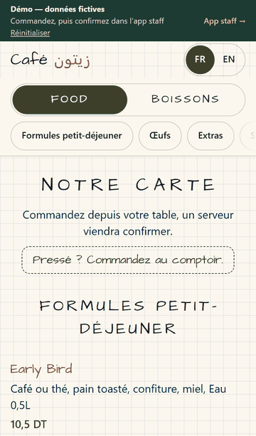
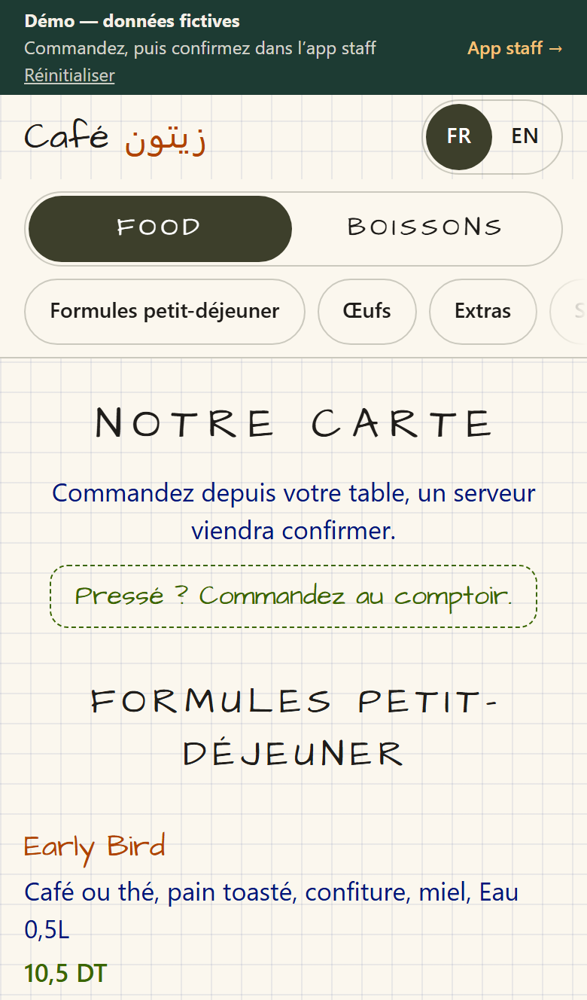
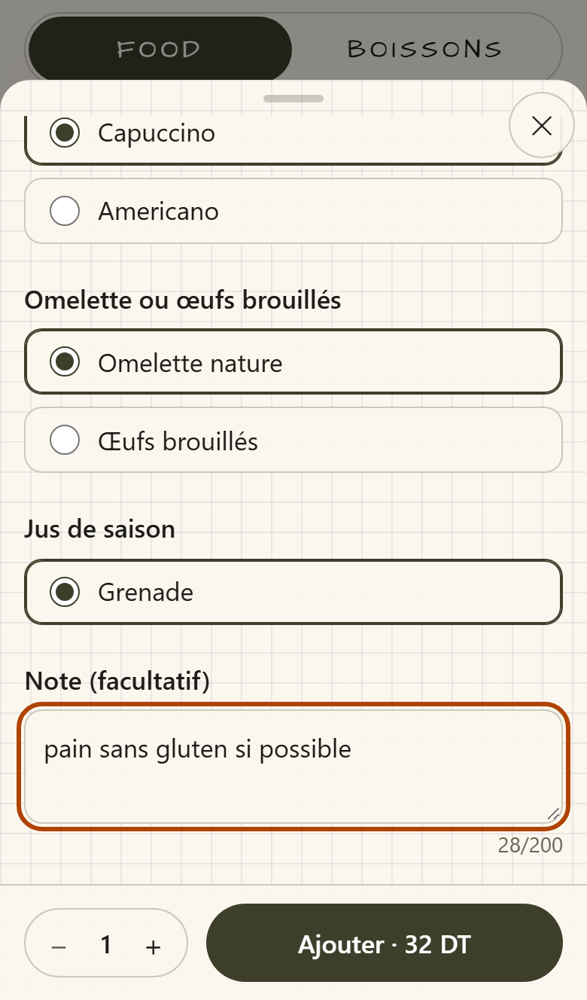
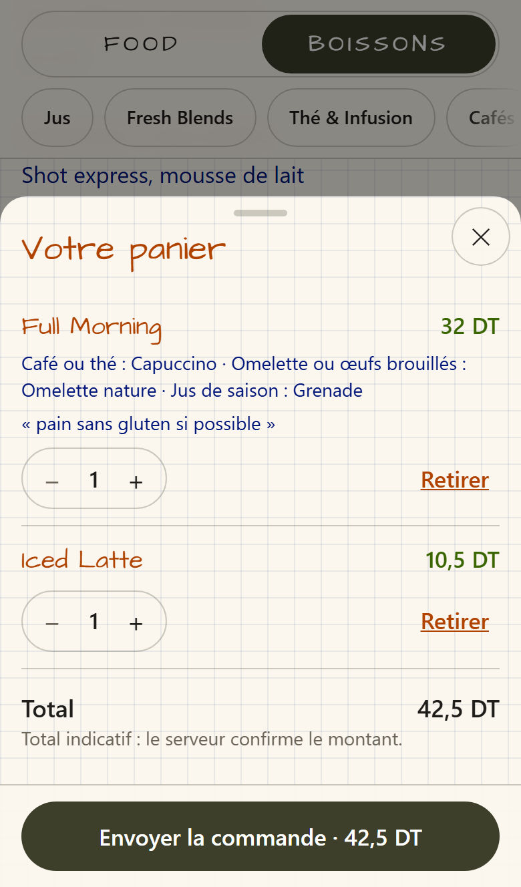
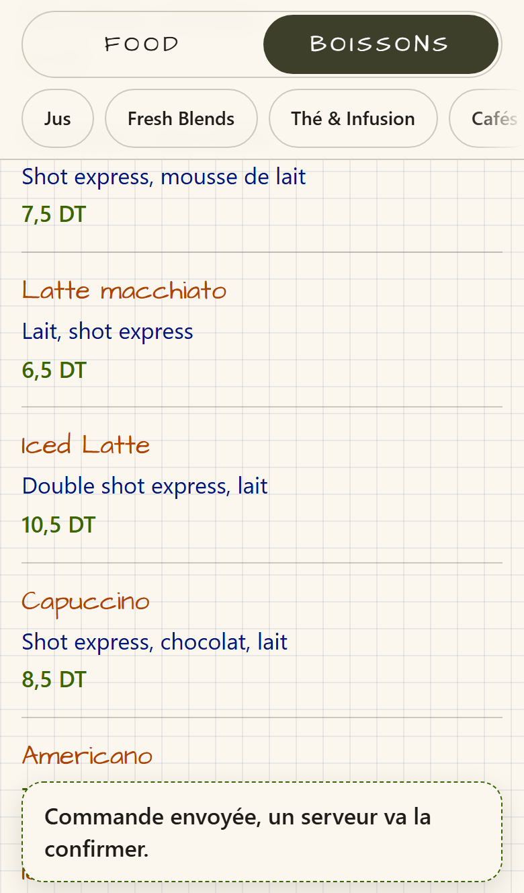
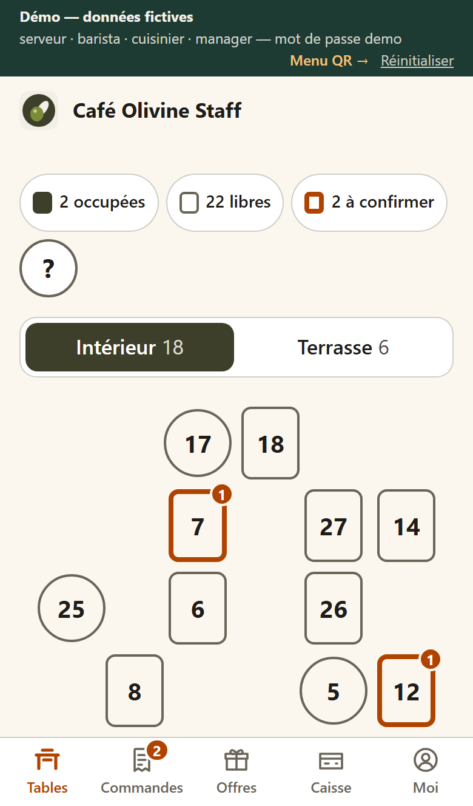
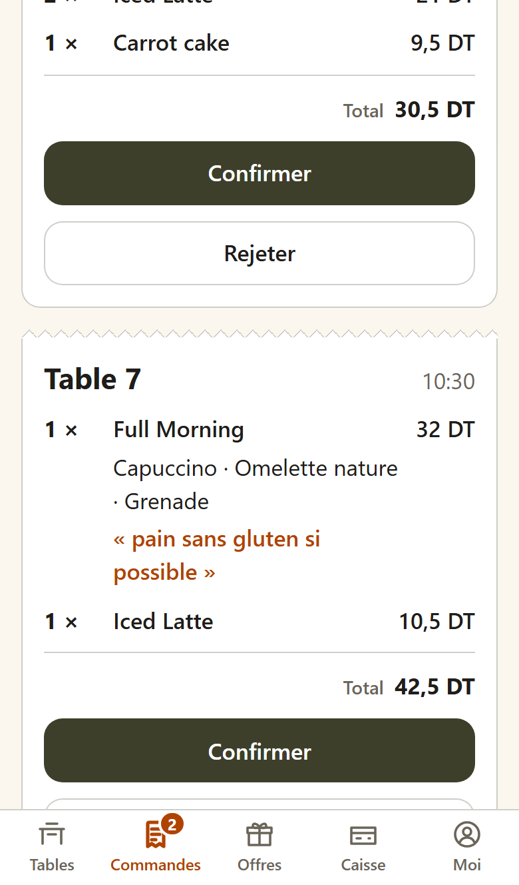
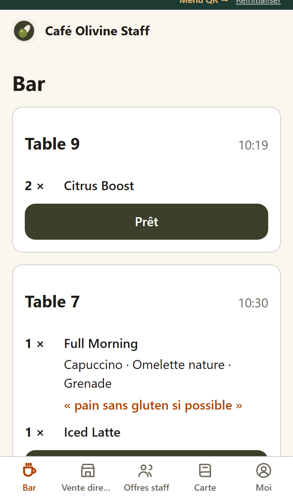
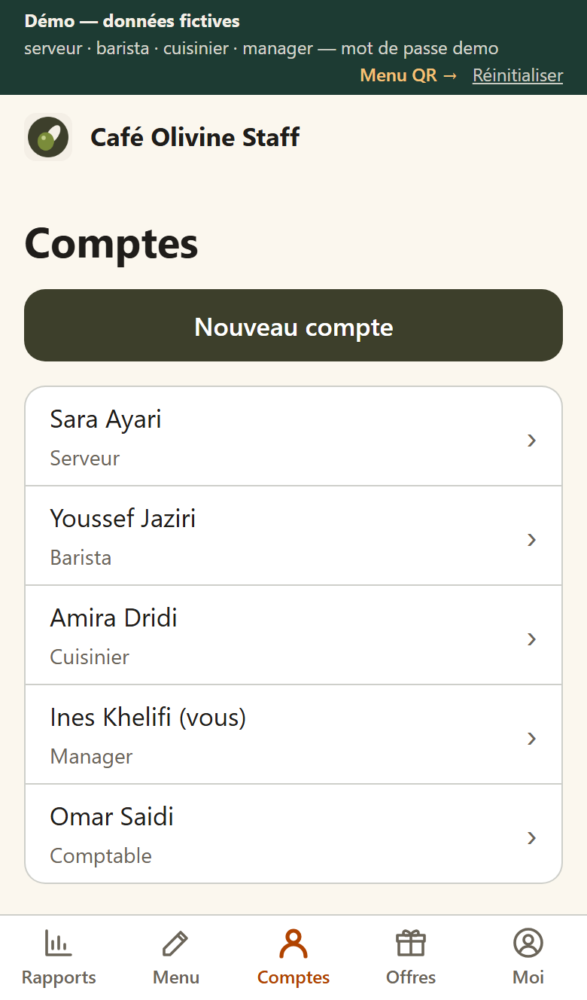
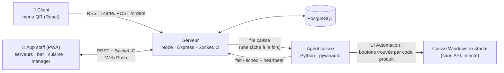

# table-to-till

**Commande par QR code à table, app du staff pour la salle, et un agent qui saisit chaque vente
dans la caisse existante du café — conçu pour un vrai coffee shop, présenté ici avec un café
fictif.**

> **En bref**
> - **Stack :** TypeScript · React + Vite (PWA) · Node.js / Express / Socket.IO / PostgreSQL · Python + pywinauto (UI Automation Windows)
> - **En chiffres :** 4 applications dans un dépôt · ~600 tests automatisés (Vitest, pytest) · menu bilingue de 86 articles · plan de 24 tables · ~100 commits à deux
> - **Démo en ligne :** **[faressjebali.github.io/table-to-till](https://faressjebali.github.io/table-to-till/)** — tout tourne dans le navigateur, données fictives

🇬🇧 [English version](README.md) · Les interfaces, les commentaires du code et la documentation
interne sont **en français** (le café est en Tunisie).

<p align="center">
  
</p>

## Le problème

Un café très fréquenté prend les commandes sur papier puis les retape dans une caisse Windows
**sans API**, qu'on ne peut pas modifier (c'est aussi la caisse fiscale). Des commandes se perdent
entre la table et le bar, les serveurs font des allers-retours, et le stock ne correspond jamais aux
ventes réelles.

## La solution

| Partie | Dossier | Pour qui |
| --- | --- | --- |
| **Menu QR** | `customer-web/` | Les clients : scanner le QR de la table, consulter la carte (FR / EN), commander, sans application |
| **App staff** (PWA) | `staff-app/` | Serveurs, baristas, cuisiniers, managers, sur leur téléphone, selon leur rôle et leur shift |
| **Serveur** | `server/` | API REST, temps réel, PostgreSQL, file des tâches pour la caisse |
| **Agent caisse** | `pos-agent/` | Sur le PC de caisse : saisit chaque commande dans l'interface de la caisse, comme un humain |

### Parcours client

1. Scanner le QR de la table (il contient un jeton aléatoire, pas le numéro de table).
2. Parcourir la carte, ouvrir un article : extras suggérés, choix des formules (café ou thé, œufs,
   jus), quantité, note libre.
3. Envoyer le panier. Le serveur recalcule chaque prix et vérifie horaires et ruptures.
4. « Commande envoyée, un serveur va la confirmer » → « Confirmée ». Sans confirmation, la commande
   expire au bout de 5 minutes.

### Parcours staff et caisse

1. Tous les serveurs en shift sont prévenus (son + notification push) ; le premier disponible
   vérifie avec la table et **confirme** (ou rejette une fausse commande). Les serveurs peuvent
   aussi saisir une commande eux-mêmes.
2. Le bar et la cuisine voient **seulement leurs lignes** (avec choix et notes) et appuient sur
   **Prêt** ; les serveurs reçoivent « Table 7 : boissons prêtes ».
3. La commande confirmée entre dans la **file caisse**. L'agent Windows ouvre la table dans la
   caisse, trouve chaque article **par son code produit** sur les boutons, valide et rend compte.
   Il ne devine jamais : si l'écran n'est pas celui attendu, il s'arrête et l'app staff le montre.
4. La manager gère les comptes, les rôles et le menu ; shifts, passations, clôtures et rapports de
   stock sont spécifiés dans `docs/product.md`.

| | | | |
| :-: | :-: | :-: | :-: |
|  |  |  |  |
| Menu QR | Formule avec choix | Panier | En attente du serveur |
|  |  |  |  |
| Plan des tables (serveur) | Commandes entrantes | Écran bar | Comptes (manager) |

<sub>Captures du mode démo : café et données fictifs, horloge de démo fixée au vendredi 10h30.</sub>

## Essayer

**En ligne :** [la démo](https://faressjebali.github.io/table-to-till/) montre les deux téléphones
côte à côte. Commandez depuis la table 7 à gauche, confirmez comme serveur à droite, puis
connectez-vous en `barista` ou `cuisinier` (mot de passe `demo`) et appuyez sur **Prêt**. Rien ne
quitte votre navigateur.

**En local, en mode démo** (Node 22, sans base de données ni `.env`) :

```bash
git clone https://github.com/faressjebali/table-to-till.git && cd table-to-till
(cd customer-web && npm ci) && (cd staff-app && npm ci)
npm run demo        # → http://localhost:4173/
```

**Tout le projet** (Docker pour PostgreSQL) :

```bash
cp .env.example .env            # valeurs locales seulement
docker compose up -d            # PostgreSQL sur 127.0.0.1
npm ci && (cd server && npm ci && npm run migrate && npm run seed && npm run dev)
(cd customer-web && npm ci && npm run dev)   # http://localhost:5173/t/<jeton de table>
(cd staff-app && npm ci && npm run dev)      # http://localhost:5174
```

Tests : `npm run lint`, puis `npm test` dans `server/` (PostgreSQL requis), `customer-web/`,
`staff-app/`, et `python -m pytest` dans `pos-agent/`. Détails dans [`demo/README.md`](demo/README.md).

## Architecture



## Stack

- **Front :** React 19, TypeScript strict, Vite, propriétés CSS (jetons de design, clair / sombre),
  PWA installable avec service worker et notifications push (iOS 16.4+), Vitest + Testing Library.
- **Back :** Node.js 22, Express 5, Socket.IO, PostgreSQL 16 avec migrations en SQL
  (node-pg-migrate), validation zod, mots de passe hachés avec argon2, tests Vitest sur une vraie base.
- **Agent caisse :** Python 3.12, pywinauto (UI Automation), pytest avec une fausse caisse et un faux serveur.
- **Outils :** ESLint (avec les types côté serveur), Prettier, Ruff, CI GitHub Actions.

## Choix techniques

- **Le contrat d'API d'abord.** `docs/api.md` fait foi (versionné, avec historique) ; serveur et
  apps le suivent exactement, chaque changement passe par une PR dédiée.
- **Le serveur calcule tous les prix**, en **millimes** entiers (1 DT = 1000) : jamais de
  décimaux, jamais un prix venu du client.
- **Automatiser une caisse sans API.** L'agent pilote la vraie interface par UI Automation,
  trouve les contrôles par identifiant / nom / texte (jamais par coordonnées), vérifie l'écran avant
  chaque étape, compare le total de la caisse à celui du serveur avant d'encaisser, et partage la
  caisse avec les humains (il attend qu'elle soit libre et s'arrête si quelqu'un la touche).
- **Une file, un ordre par table.** Une tâche à la fois ; un échec ne bloque que les tâches
  suivantes de la même table, le reste de la salle continue.
- **Temps réel avec filet.** Salles Socket.IO par rôle et shift ; à chaque reconnexion les écrans
  rechargent par l'API, un événement manqué n'est jamais une commande perdue.
- **Fuseau maîtrisé.** Horaires évalués en Africa/Tunis ; chaque connexion à la base est réglée
  sur ce fuseau et les tests tournent en UTC pour attraper les erreurs.
- **Décisions écrites** dans `docs/decisions.md` (date, décision, raison).

## Sécurité

- Sessions du staff : jetons aléatoires de 256 bits, stockés **hachés**, 30 jours, coupés à la
  désactivation ou à la réinitialisation ; mots de passe hachés avec **argon2** ; blocage temporaire
  et limite par adresse IP à la connexion.
- Le client ne voit jamais le numéro de table : les QR portent des jetons aléatoires (renouvelables) ;
  les commandes QR sont limitées par table et confirmées par un serveur.
- Chaque entrée validée par zod ; rôle **et** shift vérifiés sur chaque route ; journal d'actions.
- En-têtes de sécurité HTTP (CSP stricte, `nosniff`, pas d'iframe, pas de referrer, HSTS en HTTPS) ;
  PostgreSQL limité à la machine locale.
- Secrets seulement dans des fichiers `.env` (jamais committés) ; le code de caisse reste sur le PC de caisse.

## Limites

- La démo en ligne est statique : un faux serveur dans le navigateur, ni agent ni encaissement.
- L'**émulateur** de caisse qui sert à tester l'agent reproduit l'interface d'un logiciel tiers :
  il **n'est pas publié**, pas plus que les données du vrai café (menu, prix, personnel, salle),
  remplacées ici par un café fictif.
- Encaissement, remises, annulations, clôtures, rapports et stock sont spécifiés
  (`docs/product.md`, `docs/api.md`) mais pas encore tous réalisés.

## Feuille de route

- Agent caisse : partage de la caisse avec les humains, gestion complète des erreurs, tests de bout
  en bout sur l'émulateur.
- App staff : encaissement et addition depuis le téléphone, remises et annulations, clôtures avec
  PDF et relevé des tickets X / Z de la caisse.
- Stock : fiches techniques, consommation théorique, inventaire hebdomadaire et écarts.
- Production : sauvegardes quotidiennes avec essais de restauration, déploiement et retour arrière.

## Équipe

Projet en binôme, **Fares Jebali** et **Idriss Rebah**, avec issues, pull requests et un contrat
d'API commun. D'après l'historique :

- **Fares Jebali** — spécification produit et l'essentiel du contrat d'API ; le menu QR ; la plus
  grande partie de l'app staff (système de design, plan des tables, commandes entrantes, saisie
  d'une commande, écran bar / cuisine, shifts) ; côté serveur, menu, tables, shifts, bar / cuisine et
  file caisse ; l'agent caisse Python ; durcissement de la sécurité ; cette vitrine et son mode
  démo.
- **Idriss Rebah** — mise en place du dépôt et des outils (ESLint, Prettier, Ruff, CI) ; schéma de
  la base et migrations ; authentification et sessions du staff ; gestion des comptes (API et écran
  de la manager, rôles et titres) ; cycle de vie des commandes QR (créer, confirmer, rejeter,
  expirer) et commandes saisies par un serveur ; temps réel Socket.IO ; notifications push ;
  déploiement de staging.

## Licence

© 2026 Fares Jebali & Idriss Rebah — All rights reserved. Le code est publié uniquement à titre de
portfolio ; aucune réutilisation sans autorisation.
