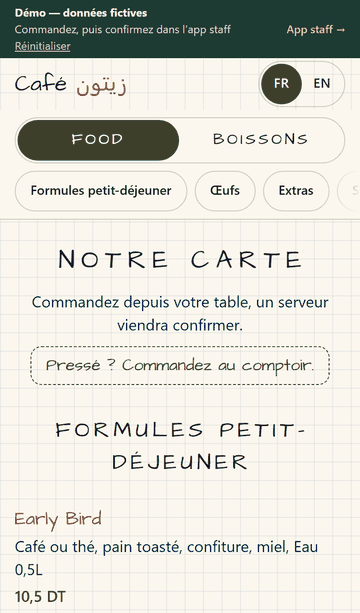
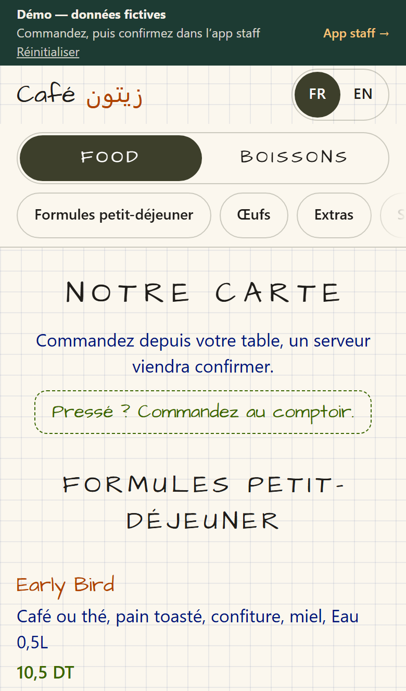
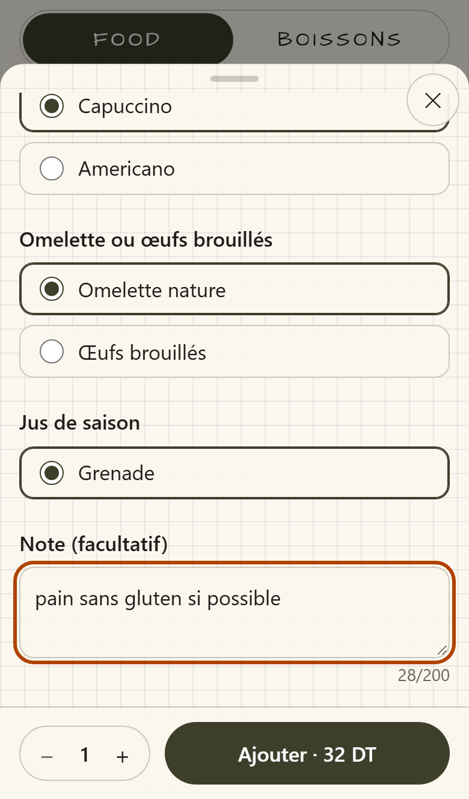
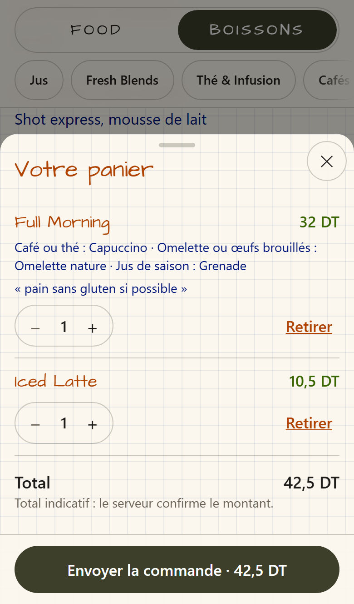
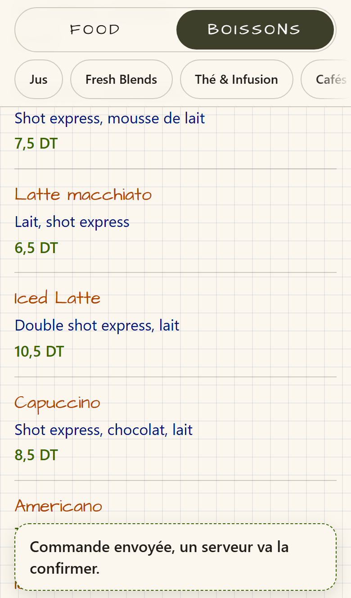
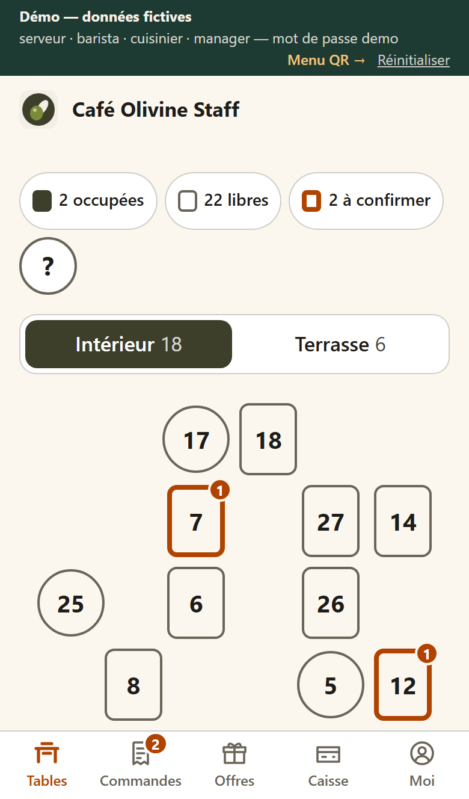
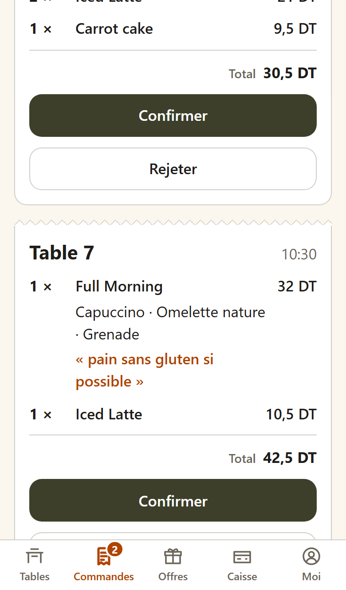
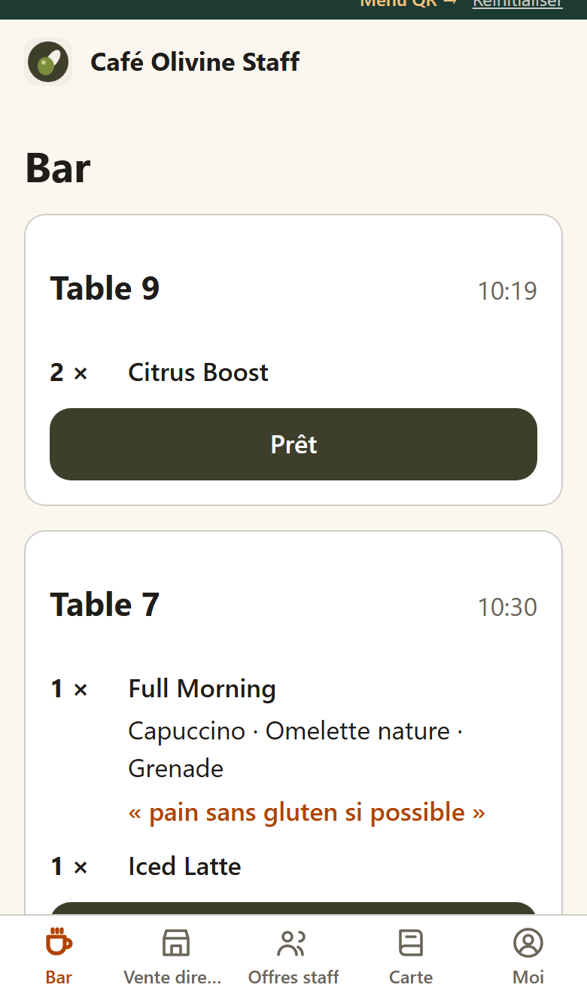
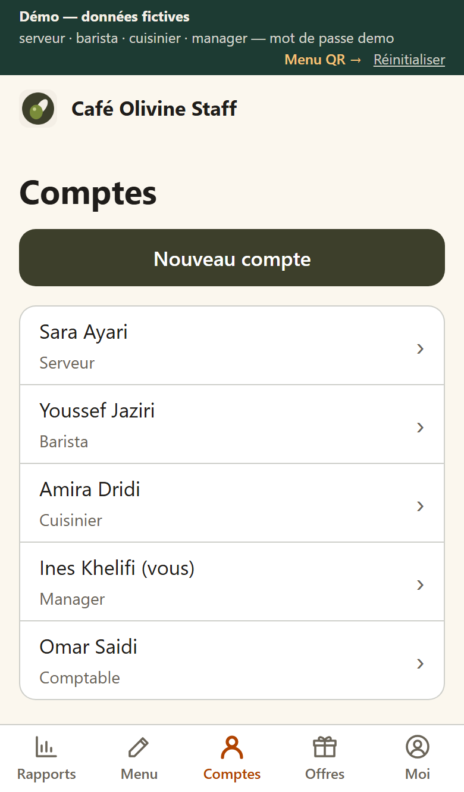
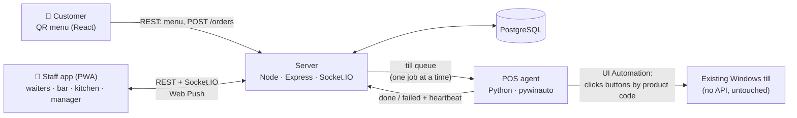

# table-to-till

**QR ordering at the table, a staff app for the floor, and an agent that types every sale into a
café's existing till — built for a real coffee shop, shown here with a fictional one.**

> **Highlights**
> - **Stack:** TypeScript · React + Vite (PWA) · Node.js / Express / Socket.IO / PostgreSQL · Python + pywinauto (Windows UI Automation)
> - **In numbers:** 4 apps in one repo · ~600 automated tests (Vitest, pytest) · 86-item bilingual menu · 24-table floor plan · ~100 commits by a team of two
> - **Live demo:** **[faressjebali.github.io/table-to-till](https://faressjebali.github.io/table-to-till/)** — runs entirely in your browser, fictional data

🇫🇷 [Lire en français](README.fr.md) · The user interfaces, code comments and internal docs are **in
French** (the café is in Tunisia); this README is the English overview.

<p align="center">
  
</p>

## The problem

A busy café takes orders on paper and re-types them into a Windows till that has **no API** and
must not be modified (it is also the fiscal register). Orders get lost between the table and the
bar, waiters walk back and forth, and stock figures never match what was actually sold.

## The solution

| Part | Folder | For whom |
| --- | --- | --- |
| **QR menu** | `customer-web/` | Customers: scan the table's QR code, browse the menu (FR / EN), order. No app to install |
| **Staff app** (PWA) | `staff-app/` | Waiters, baristas, cooks, managers — on their own phones, by role and shift |
| **Server** | `server/` | REST API, real-time events, PostgreSQL, the queue of jobs for the till |
| **POS agent** | `pos-agent/` | On the till's PC: types each order into the till's UI like a human would |

### Customer journey

1. Scan the QR code on the table (it holds a random token, not the table number).
2. Browse by category, open an item: suggested extras, choices for set menus (coffee or tea, eggs,
   juice), quantity, a free-text note.
3. Send the cart. The server re-computes every price and checks opening hours and sold-out items.
4. “Order sent, a waiter will confirm” → “Confirmed”. Unconfirmed orders expire after 5 minutes.

### Staff and till journey

1. Every waiter on shift is notified (sound + Web Push); the first one available checks with the
   table and **confirms** (or rejects a fake order). Waiters can also enter orders themselves.
2. The bar and the kitchen each see **only their lines** (with choices and notes) and tap **Ready**;
   waiters get “Table 7: drinks ready”.
3. The confirmed order joins the **till queue**. The Windows agent opens the table in the till,
   finds each item **by its product code** on the buttons, validates, and reports back. It never
   guesses: if the screen is not the one expected, it stops and the staff app shows the failure.
4. The manager manages accounts, roles and the menu; shifts, hand-overs, closures and stock
   reports are specified in `docs/product.md`.

| | | | |
| :-: | :-: | :-: | :-: |
|  |  |  |  |
| QR menu | Set menu with choices | Cart | Waiting for the waiter |
|  |  |  |  |
| Floor plan (waiter) | Incoming orders | Bar screen | Accounts (manager) |

<sub>Screenshots from the demo mode, fictional café and data, demo clock set to Friday 10:30.</sub>

## Try it

**Online:** [the live demo](https://faressjebali.github.io/table-to-till/) shows both phones side
by side. Order from table 7 on the left, confirm as the waiter on the right, then sign in as
`barista` or `cuisinier` (password `demo`) and tap **Prêt**. Nothing leaves your browser.

**Locally, in demo mode** (Node 22, no database, no `.env`):

```bash
git clone https://github.com/faressjebali/table-to-till.git && cd table-to-till
(cd customer-web && npm ci) && (cd staff-app && npm ci)
npm run demo        # → http://localhost:4173/
```

**Full stack** (Docker for PostgreSQL):

```bash
cp .env.example .env            # local values only
docker compose up -d            # PostgreSQL on 127.0.0.1
npm ci && (cd server && npm ci && npm run migrate && npm run seed && npm run dev)
(cd customer-web && npm ci && npm run dev)   # http://localhost:5173/t/<table token>
(cd staff-app && npm ci && npm run dev)      # http://localhost:5174
```

Tests: `npm run lint`, then `npm test` in `server/` (needs PostgreSQL), `customer-web/`,
`staff-app/`, and `python -m pytest` in `pos-agent/`. More in [`demo/README.md`](demo/README.md).

## Architecture



## Stack

- **Front-end:** React 19, TypeScript (strict), Vite, CSS custom properties (design tokens, light /
  dark), installable PWA with service worker and Web Push (iOS 16.4+), Vitest + Testing Library.
- **Back-end:** Node.js 22, Express 5, Socket.IO, PostgreSQL 16 with plain-SQL migrations
  (node-pg-migrate), zod validation, argon2 password hashing, Vitest against a real database.
- **POS agent:** Python 3.12, pywinauto (UI Automation), pytest with a fake till and a fake server.
- **Tooling:** ESLint (type-aware on the server), Prettier, Ruff, GitHub Actions CI.

## Technical choices

- **API contract first.** `docs/api.md` is the single source of truth (versioned, with a change
  log); server and apps follow it exactly, and every change goes through a dedicated pull request.
- **The server computes every price**, in integer **millimes** (1 DT = 1000) — never floats, never
  a price sent by a client.
- **Automating a till without an API.** The agent drives the real UI through Windows UI
  Automation, finds controls by id / name / text (never by coordinates), checks the expected screen
  before each step, compares the till's total with the server's before taking a payment, and
  shares the till with humans (it waits for an idle till and stops when someone touches it).
- **One queue, per-table ordering.** Jobs run one at a time; a failed job blocks only the
  following jobs of the same table, so the rest of the room keeps flowing.
- **Real time with a safety net.** Socket.IO rooms by role and shift; on every reconnection the
  screens reload from the REST API, so a missed event is never a lost order.
- **Time zone discipline.** Opening hours are evaluated in Africa/Tunis; every DB connection is
  pinned to that zone and the tests run in UTC to catch mistakes.
- **Decisions are written down** in `docs/decisions.md` (date, decision, reason).

## Security

- Staff sessions: random 256-bit tokens, stored **hashed**, 30-day expiry, revoked on deactivation
  or password reset; passwords hashed with **argon2**; temporary lockout and per-IP rate limit on login.
- Customers never see table numbers: QR codes carry random tokens (rotatable); QR orders are
  rate-limited per table and must be confirmed by a waiter.
- Every input validated with zod; roles **and** shift checked on each route; actions written to an
  audit log.
- HTTP security headers (strict CSP, `nosniff`, frame denial, no referrer, HSTS behind HTTPS);
  PostgreSQL bound to localhost.
- Secrets only in `.env` files (never committed); the till's code lives only on the till's PC.

## Limitations

- The live demo is static: a fake backend in the browser, no agent, no payments.
- The register **emulator** we use to test the agent reproduces a third-party interface, so it is
  **not published**; neither are the real café's data (menu, prices, staff, layout), replaced here
  by a fictional café.
- Payments, discounts, cancellations, shift closures, reports and stock are specified
  (`docs/product.md`, `docs/api.md`) but not all implemented yet.

## Roadmap

- POS agent: sharing the till with humans, full error handling, end-to-end tests on the emulator.
- Staff app: payment and bill printing from the phone, discounts and cancellations, closures with
  a PDF report and a reading of the till's X / Z tickets.
- Stock: recipes per item, theoretical consumption, weekly inventory and variance reports.
- Production: daily database backups with restore drills, deployment and rollback.

## Team

A two-person project by **Fares Jebali** and **Idriss Rebah**, working with issues, pull requests
and a shared API contract. From the commit history:

- **Fares Jebali** — product specification and most of the API contract; the QR menu; most of the
  staff app (design system, floor plan, incoming orders, waiter order entry, bar / kitchen screen,
  shifts); server modules for the menu, tables, shifts, bar / kitchen and the till queue; the
  Python POS agent; security hardening; this showcase and its demo mode.
- **Idriss Rebah** — project setup and tooling (ESLint, Prettier, Ruff, CI); database schema and
  migrations; staff authentication and sessions; account management (API and manager screen,
  roles and titles); QR order lifecycle (create, confirm, reject, expire) and waiter orders;
  Socket.IO real time; Web Push notifications; staging deployment.

## License

© 2026 Fares Jebali & Idriss Rebah — All rights reserved. The code is published for portfolio
purposes only; no reuse without permission.
